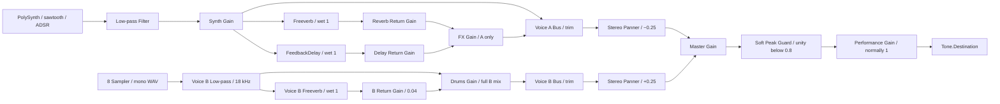

# DUOTONE MINI — техническая документация

[Вернуться к кейсу](../README.md)

Подробности текущей реализации: управление, параметры аудиографа, загрузка сэмплов, MIDI и проверки. Основной README описывает проект как дизайн-кейс; этот документ сохраняет сведения для технического разбора.

## Управление и MIDI

Запустите приложение через локальный HTTP-сервер и нажмите клавишу, пэд или Play: пользовательское действие активирует аудиоконтекст через `Tone.start()`. Без Hold нота синтезатора звучит до отпускания клавиши, после чего проходит фазу Release. Пэд запускает конечный сэмпл целиком — отпускание не обрывает его хвост.

| Элемент | Действие и фактическое поведение |
| --- | --- |
| Piano / Voice A | 25 клавиш, исходный диапазон C3–C5. Игра мышью, касанием или клавиатурой компьютера; поддерживаются аккорды. |
| 8 pads / Voice B | Ручной запуск ударных. На пэде в фокусе работают Space / Enter; отдельной раскладки горячих клавиш для восьми пэдов нет. |
| Hold | Фиксирует ручные ноты по высоте: повторное нажатие той же ноты снимает только её. Включение подхватывает уже удерживаемые ноты; выключение снимает все фиксации. MIDI и барабаны от Hold не зависят. |
| Oct− / Oct+ | Транспонируют экранную и компьютерную клавиатуру на ±2 октавы. Уже звучащие ручные ноты сохраняют высоту; импортированный MIDI не транспонируется. |
| Play | Запускает циклический барабанный рисунок и, если загружен MIDI, однократное исполнение мелодии с начала. Повторный Play не создаёт дубликаты. |
| Stop | Останавливает транспорт, возвращает позицию к началу, снимает ноты и останавливает барабаны. Параметры, режим Hold и импортированный файл сохраняются; зафиксированные ноты очищаются. |
| BPM | Исходно 120 BPM; обычный диапазон 50–200. Enter или выход из поля применяет значение, стрелки меняют его сразу. Темп влияет на MIDI и ритм одновременно. |
| IMPORT | Открывает локальный `.mid` / `.midi`. После успешного импорта воспроизведение останавливается; для запуска нужен Play. Подпись «MIDI IMPORT» соответствует поддерживаемым файлам; WAV/MP3 не принимаются. |
| 8 knobs | Cutoff, Resonance, Reverb, Delay и ADSR. Перетаскивание вверх/вправо увеличивает значение; вниз/влево уменьшает. В фокусе доступны стрелки, Home и End. |
| Synth / Drums / FX / Master | Четыре фейдера уровня. Нижнее положение полностью заглушает соответствующий канал; FX регулирует возвраты эффектов Voice A. |

### Раскладка компьютерной клавиатуры

Соответствие при `OCTAVE ±0`, слева направо по высоте:

| Ноты | Клавиши |
| --- | --- |
| C3 · C♯3 · D3 · D♯3 · E3 · F3 · F♯3 · G3 · G♯3 · A3 · A♯3 · B3 | Z · S · X · D · C · V · G · B · H · N · J · M |
| C4 · C♯4 · D4 · D♯4 · E4 · F4 · F♯4 · G4 · G♯4 · A4 · A♯4 · B4 · C5 | Q · 2 · W · 3 · E · R · 5 · T · 6 · Y · 7 · U · I |

Обработчики используют `KeyboardEvent.code`, поэтому привязка следует физическим позициям клавиш и сохраняется при смене языковой раскладки. Автоповтор удерживаемой клавиши подавляется. При редактировании полей ввода мелодические горячие клавиши отключаются. При потере фокуса окна или скрытии страницы исполнение останавливается и ноты освобождаются.

### MIDI и автоматическое исполнение

Импорт выбирает **одну непустую мелодическую дорожку с наибольшим количеством валидных нот**; при равенстве — первую по порядку. Дорожки, распознанные как ударные, включая канал 10, исключаются. Поддерживаются Standard MIDI форматов 0/1 с PPQ; формат 2 и SMPTE-тайминг не поддерживаются. Лимиты — 5 МБ на файл и 50 000 нот в выбранной дорожке. Неудачный импорт сохраняет предыдущую мелодию.

Применяется первое валидное значение темпа из MIDI; дальнейшие изменения темпа внутри файла игнорируются. Без метаданных темпа остаётся текущий BPM. Если импортированный темп выходит за 50–200, границы поля расширяются под него. С импортированным MIDI всё исполнение автоматически завершается по последнему note-off выбранной дорожки. Без MIDI барабанный цикл продолжается до ручного Stop. Ручная игра доступна одновременно с обеими последовательностями.

## Звуковая архитектура

Реализация сосредоточена в [script.js](../script.js) и [midi-import.js](../midi-import.js). Оба слоя имеют собственные инструменты и регуляторы уровня, но суммируются в общий Master.

### Voice A — полифонический синтезатор

Используется `Tone.PolySynth(Tone.Synth)` с `maxPolyphony = 32`: для разных одновременно звучащих высот выделяются голоса `Tone.Synth`. Лимит включает ещё затухающие Release-голоса; плотный материал с Release 6 s может превысить 32 голоса и привести к пропуску новых атак. При исполнении длинного плотного MIDI следует выбирать подходящий Release. Осциллятор каждого голоса настроен на **sawtooth**, пилообразную волну. Переключателя формы волны, дополнительных осцилляторов и системы модуляции в интерфейсе нет.

Громкость голоса задана как −18 dB, velocity ручной игры — 0,8; MIDI передаёт собственную velocity. Совпадающие по высоте ручные и MIDI-ноты используют общее удержание: отпускание одного источника не обрывает другой. Перекрывающиеся MIDI-ноты одной высоты учитываются счётчиком и не запускают отдельные повторные атаки.

После синтезатора стоит общий `Tone.Filter`: low-pass, спад −24 dB/октаву. ADSR относится к амплитудной огибающей `Tone.Synth`; отдельной огибающей фильтра нет.

| Параметр | Начальное значение | Диапазон / преобразование |
| --- | --- | --- |
| Cutoff | 2400 Гц | 80–16 000 Гц, логарифмическая шкала |
| Resonance | 32% | 0–100%; `Q = 0.5 + value × 7.5`, то есть Q 0,5–8; исходно Q 2,9 |
| Attack | 12 мс | 2 мс–2 с, логарифмическая шкала |
| Decay | 480 мс | 20 мс–3 с, логарифмическая шкала |
| Sustain | 76% | 0–100% амплитуды |
| Release | 1,2 с | 30 мс–6 с, логарифмическая шкала |
| Reverb | 28% | 0–100% gain возврата реверберации |
| Delay | 18% | 0–100% gain возврата задержки |

### Эффекты и маршрутизация

После фильтра сигнал проходит через Synth Gain. Затем он разветвляется: сухой сигнал идёт в Voice A Bus, а две **параллельные** ветви — в `Tone.Freeverb` и `Tone.FeedbackDelay`. Реверберация не поступает в задержку и наоборот.

- **Freeverb:** `roomSize = 0.72`, `dampening = 4500` Гц, `wet = 1`.
- **FeedbackDelay:** `delayTime = 0.25` с, `feedback = 0.28`, `wet = 1`. Задержка фиксирована в секундах и не синхронизируется с BPM.
- Ручки Reverb / Delay управляют отдельными Gain **после** эффектов; фейдер FX — их общим уровнем перед Voice A Bus. Это уровни возвратов, а не изменение `wet` самих эффектов.
- Synth Gain регулирует одновременно сухой сигнал и вход в обе ветви эффектов. Фильтр и эффекты Voice A не обрабатывают барабаны.



### Voice B — сэмплерные ударные

Каждому пэду соответствует отдельный `Tone.Sampler` с одним локальным WAV и собственной корневой нотой. Сэмпл запускается через `triggerAttack()` на этой же ноте, то есть без транспонирования. Самплеры имеют `attack = 0.001` с, `release = 0.05` с и громкость −6 dB; velocity ручного удара — 0,9. Все восемь подключены к одному собственному Voice B Filter.

| Пэд | Корневая нота | Файл в `assets/audio/` | Запись |
| --- | --- | --- | --- |
| Kick | C1 | `BT7A0D0.WAV` | Бас-барабан TR-909 |
| Snare | D1 | `ST0T3S7.WAV` | Малый барабан TR-909 |
| Clap | D♯1 | `HANDCLP1.WAV` | Хлопок |
| Closed HH | F♯1 | `HHCD6.WAV` | Закрытый хай-хэт |
| Open HH | A♯1 | `HHOD6.WAV` | Открытый хай-хэт |
| Low tom | F1 | `LT3D7.WAV` | Низкий том |
| Perc | G1 | `RIM127.WAV` | Римшот |
| Texture | C2 | `CSHD6.WAV` | Крэш-тарелка |

Записи взяты из `tutorial_4/roland_tr_909/` курса преподавателя. Это восемь разных монофонических PCM WAV с частотой 44,1 кГц; происхождение, длительности и контрольные суммы приведены в [assets/audio/README.md](../assets/audio/README.md).

Сэмплы загружаются по требованию. Первое нажатие ждёт загрузку; несколько запросов одного пэда во время загрузки сводятся к последнему. Ошибка одного файла не блокирует остальные пэды; следующее нажатие повторяет загрузку. Предусмотрен тайм-аут 15 секунд и сообщения на дисплее. Play предварительно загружает Kick, Snare и Closed HH для ритмического цикла.

### Обработка Voice B и стереопозиционирование

Voice B Filter — low-pass 18 000 Hz, rolloff −12 dB/октаву, Q 0,5. За ним две параллельные ветви: сухая прямо в Drums Gain и собственный Freeverb (`roomSize = 0.18`, `dampening = 6000` Hz, `wet = 1`) через Return Gain 0,04 в тот же Drums Gain. Это аддитивный сухой/обработанный микс: сухая ветвь имеет unity gain, эффект добавлен на малом уровне. Значение 0,04 — уровень возврата, не процент `wet` или нормализованная доля всего микса. Фейдер Drums находится после суммирования и управляет всем B, включая хвосты. Ни один путь B не подключён к FX Gain, фильтру или эффектам A.

Voice A Bus (`synthBus`) собирает сухой Synth Gain и FX Gain. Voice B Bus (`drumBus`) принимает полный Drums Gain. Только выходы двух Panner подключаются к Master; обходных прямых соединений голосов с Master нет. `Tone.Panner` явно использует `channelCount: 2`, а шины — два канала с `channelCountMode = explicit`, чтобы сохранять стереосигнал эффектов даже при нулевом возврате. Pan A = −0,25; pan B = +0,25. Новых контролов панорамы нет.

Обе шины имеют фиксированный trim `1 / sqrt(1 + sin(abs(pan) × π / 2)) ≈ 0.85043` (−1,41 dB). Он компенсирует рост суммарной L/R-энергии коррелированного центрального сухого источника при стереопанорамировании. Декоррелированные возвраты могут немного изменить суммарный уровень. Калибровка не меняет значения фейдеров. Synth = 0 перекрывает сухой A и новые входы в его эффекты, но уже созданные хвосты A могут продолжаться; FX = 0 заглушает их возвраты. Drums = 0 перекрывает полный B, включая хвосты его реверберации. Для остановки всех хвостов обоих голосов используется Stop или автоматический финал.

Независимые шины, панорамирование и изоляция каналов различаются: здесь независимые сухие/FX-тракты и умеренное позиционирование полных голосов. Оба голоса присутствуют в обоих каналах; строгой изоляции «A только L / B только R» нет. Моносовместимость проверяется суммированием `(L + R) / 2` в реальных аудиорендерах.

Master Gain направлен в фиксированный `outputGuard` (`Tone.WaveShaper`, 4097 точек), затем в Performance Gain и Destination. Защита добавлена после измеренной перегрузки 25-нотного аккорда с барабанами при максимальных фейдерах; новых органов управления нет. При абсолютной амплитуде ≤0,8 кривая линейна и сохраняет уровень; выше используется `sign(x) × (0.8 + 0.15 × tanh((abs(x) − 0.8) / 0.15))`. На границе входного диапазона WaveShaper ±1 выход составляет около ±0,9305; вход за границей насыщается этим значением. Oversampling не включён. Это намеренная мягкая сатурация перегруженного микса, а не настройка тембра или измеритель уровня. Она действует отдельно на оба канала, не меняет фазу/задержку обычного сигнала и не создаёт хвостов. При обычном уровне Master линейно масштабирует микс; при перегрузке защита ограничивает пики. Performance Gain стоит после защиты и плавно гасит оба стереоканала вместе. Стереоизображение в перегруженном миксе может меняться из-за насыщения каждого канала; проверка баланса/моно относится к нормальным рабочим уровням.

### Микшер и транспорт

Synth, Drums, FX и Master реализованы через `Tone.Gain` с линейными значениями 0–1. Начальные уровни: Synth −3 dB, Drums −6 dB, FX 24%, Master −1 dB. Уровни громкости отображаются в dB, FX — в процентах. Изменения gain, cutoff и Q сглаживаются через `rampTo()` за 25 мс; ADSR обновляется через `synth.set()`.

Барабанный рисунок — циклическая `Tone.Sequence` из восьми восьмых: Kick на долях 1 и 3, Snare на 2 и 4, Closed HH на каждой восьмой. Velocity: Kick 0,9; Snare 0,85; хай-хэт чередует 0,55 и 0,4. Редактора шагов в текущем интерфейсе нет.

MIDI преобразуется в события включения и выключения нот внутри нециклической `Tone.Part`. Тики файла пересчитываются по отношению PPQ файла и транспорта, округляются; минимальная длительность — один тик транспорта. В обработчике числовая MIDI-высота превращается в имя ноты для `triggerAttack()` / `triggerRelease()`. Ручная игра и MIDI используют тот же фильтр, огибающую, микшер и эффекты. Control Change, педаль sustain, Program Change и объединение дорожек не применяются.

`Tone.getDraw()` синхронизирует MIDI-подсветку и вспышки пэдов с аудиовременем. MIDI-ноты за пределами видимого диапазона продолжают звучать, но не подсвечивают клавиши.

## Структура, запуск и проверки

### Стек

- **HTML, CSS, JavaScript** без фреймворков, сборки и установки npm-зависимостей.
- **Tone.js 15.1.22** — Web Audio, синтез, сэмплеры, эффекты и транспорт; библиотека включена локально.
- **@tonejs/midi** — локальная браузерная сборка парсера MIDI в `assets/vendor/Midi.js`. В прежней документации указана версия 2.0.28; номер не встроен в текущий файл сборки, поэтому отдельно по нему не подтверждён. Включённые зависимости — `midi-file` и `array-flatten`; отдельная установка не нужна.
- **Inter / IBM Plex Mono**, локальные TTF, SVG элементов интерфейса и WAV ударных.

Приложение обрабатывает выбранный MIDI локально через `File.arrayBuffer()`; серверная обработка файла не используется. Ресурсы инструмента загружаются с того же сайта, запросов к CDN в `index.html` нет. Лицензии библиотек и шрифтов сохранены в `assets/vendor/` и `assets/fonts/`; сведения о записях — в `assets/audio/README.md`.

### Структура проекта

```text
duotone-mini/
├── index.html                 # Основной экран и подключение скриптов
├── css/
│   ├── reset.css              # Базовый CSS reset
│   └── style.css              # Визуальный дизайн, состояния, адаптивность
├── script.js                  # Аудиограф, контролы, ручная игра, ритм
├── midi-import.js             # Разбор MIDI и расписание нот
├── assets/
│   ├── audio/                 # 8 WAV и сведения об их происхождении
│   ├── ui/                    # SVG элементов утверждённого интерфейса
│   ├── fonts/                 # Inter, IBM Plex Mono и лицензии
│   └── vendor/                # Tone.js, MIDI-парсер и лицензии
├── tests/
│   ├── phase1.test.js         # Проверки логики и маршрутизации
│   ├── browser-audio.html     # Проверки с настоящими узлами Tone.js
│   ├── browser-midi.html      # Проверки MIDI и взаимодействий
│   ├── browser-playback.html  # Стереофинал, Stop и восстановление
│   ├── create-midi-fixtures.js
│   └── fixtures/              # Тестовые MIDI, включая ошибочные файлы
├── docs/
│   ├── technical.md           # Техническая документация
│   └── interface.png          # Скриншот для README
└── README.md
```

### Интерфейс и именование

| Блок | HTML / CSS | Повторные элементы / управление |
| --- | --- | --- |
| Utility | `.utility-panel` | OLED, BPM, Octave, MIDI Import |
| Controls / Transport | `.performance`, `.transport` | Hold, Oct−/Oct+, Play/Stop |
| Voice A / Keyboard | `.synth-controls`, `.melody-keyboard` | `.knob`, `.piano-key`; `parameters`, `keyboardCodes` |
| Voice B / Pads | `.sampler-controls` | `.pad`; `drumSamples`, `padStates` |
| Mixer | `.mixer` | `.fader`; Synth, Drums, FX, Master |

Светлый корпус, разделительные швы и скругления связывают экран с компактным аппаратным MIDI-контроллером. Электрический синий `#167bff` обозначает действие/активность. Inter используется для обычных подписей, IBM Plex Mono — для нот, чисел и технических данных. Waveform — декоративный SVG; полосы фейдеров показывают установленный gain, не измеренную громкость. Внешние MIDI-контроллеры через Web MIDI API не подключаются.

OLED временно показывает ударный звук или результат импорта, затем имя `importedMidi.filename`; без файла сохраняется исходное название Glass Horizon. Текст записывается через `textContent`, длинное имя визуально сокращается существующим ellipsis. Play/Stop и параметры не сбрасывают имя файла.

### Локальный запуск

Нужны Python 3 и современный браузер с Web Audio. Из корня репозитория выполните:

```sh
python3 -m http.server 8000 --bind 127.0.0.1
```

Откройте [http://127.0.0.1:8000](http://127.0.0.1:8000) и нажмите клавишу, пэд или Play для активации звука. Сборка и установка пакетов не требуются. После получения репозитория приложение можно запускать локально без доступа к интернету. Альтернатива — уже установленный VS Code Live Server. Локальная настройка `.vscode/settings.json` задаёт порт 5501; она не включена в репозиторий. Каталоги `.vscode/`, `presentation/` и файл `AGENTS.md` остаются локальными и исключены из Git.

### Проверки

При наличии Node.js запустите существующий набор без установки зависимостей:

```sh
node tests/phase1.test.js
```

Он проверяет раскладку, аккорды, Hold, октавы, отмену событий, загрузку сэмплов, маршрутизацию, транспорт, темп, ошибки импорта и парсинг настоящих тестовых MIDI. Аудиоузлы в этом наборе заменены записывающими вызовы объектами: он проверяет логику, но не качество звука.

Для проверки с настоящим Tone.js на запущенном сервере доступны [tests/browser-audio.html](http://127.0.0.1:8000/tests/browser-audio.html) и [tests/browser-midi.html](http://127.0.0.1:8000/tests/browser-midi.html). Нажмите соответственно **Run audio checks** и **Run MIDI checks**. Эти страницы используют офлайн-рендеринг аудио и проверки взаимодействий; сами по себе они не заменяют прослушивание. Для проверки мультитача и качества звучания нужно практическое исполнение на целевом устройстве.


### Завершение и проверка playback

`parseMidi` сохраняет максимальные `ticks + durationTicks` и `time + duration` выбранной мелодической дорожки. `scheduleMidi` переводит каждый note-off в PPQ транспорта и назначает один `scheduleOnce` на последний note-off. Как и раньше, расписание использует начальный темп и текущее поле BPM, а не последующие tempo events файла. Очистка удаляет этот callback вместе с Part и Sequence; поколения воспроизведения защищают от старых Draw callbacks и загрузок сэмплов.

Финал использует переданное аудиовремя callback, а не момент его раннего вызова в lookahead. В этот момент останавливается Transport, освобождаются голоса и сэмплы; Play, клавиши и краткое `FINISHED` обновляются через Draw. Отдельный unity Gain после Master гасит общий сухой, барабанный и FX-сигнал за 300 мс. После затухания повторный короткий release убирает уже запланированные атаки и длинные огибающие; feedback обоих Freeverb и FeedbackDelay временно обнуляется на 350 мс для очистки буферов. Затем unity Gain и feedback автоматически возвращаются. Уровни фейдеров, ручки и Hold не меняются. Новые ручные ноты/пэды и Play ждут окончания этой короткой очистки; узлы графа не пересоздаются. Ручной Stop выполняет такую же очистку.

Подсветка обозначает только нажатые/зафиксированные ноты и активные MIDI note-on до note-off, а не release или FX. MIDI-ноты вне текущего диапазона играют на исходной высоте; существующая подпись диапазона показывает pitch и `↑ ABOVE` / `↓ BELOW` (до трёх высот и счётчик остальных). Автоматический ритм подсвечивает пэды, но при MIDI не заменяет OLED-информацию о мелодии.

Дополнительная страница [tests/browser-playback.html](http://127.0.0.1:8000/tests/browser-playback.html) проверяет реальный аудиорендер финала и Stop с Release 6 секунд и большими FX-возвратами, отсутствие хвостов после восстановления gain, живые Draw-события, аккорды, одинаковые перекрывающиеся высоты, ручную игру/Hold, restart и re-import. В [tests/fixtures/glass-horizon.mid](../tests/fixtures/glass-horizon.mid) сохранён короткий тестовый фрагмент: **81 нота, 40 секунд, 96 BPM, C3–C5**. Автор подтвердил длительность финального скринкаста 40 секунд. Этот файл соответствует выбранной длительности; фактическое опубликованное видео и используемый при записи файл следует сопоставить вручную. Для проверки высот вне диапазона используется отдельный тестовый MIDI с C2/C6. Офлайн-рендер измеряет сигнал, но субъективное качество финального fade и полный скринкаст следует прослушать на целевом устройстве.


### Материал Glass Horizon и внешняя проверка

В Downloads найдена `duotone-glass-horizon-full.mid`: одна мелодическая дорожка `Glass Horizon Full`, **481 нота, 119,75 секунды, 96 BPM, PPQ 480, F2–A5**. Копия сохранена как `tests/fixtures/glass-horizon-full.mid` для дополнительной проверки длинного воспроизведения и нот за пределами экранной клавиатуры. SHA-256: `7bc369efbb36c504fed27076ccadda3d306d2638ba707debdc576e36138274e7`. Два файла `glass-horizon.mid` из Downloads совпадают с коротким тестовым фрагментом по SHA-256. Таким образом, локально существуют разные версии произведения; длинная версия длится около двух минут. Автор уточнил, что в финальном скринкасте будет 40 секунд; длинный файл не используется как доказательство длительности этого видео. Фактическое содержимое ссылки Kinescope необходимо проверить вручную.

Публикация на hsedesign.ru, воспроизведение и звук скринкаста, репетиция на устройстве защиты и актуализация локальных демонстрационных материалов остаются ручными задачами. Их завершение не заявлено. Локальные демонстрационные материалы исключены из Git; ссылки на них в README не добавляются. Коммиты и обновление Pages выполняются только после разрешения автора.


### Проверенная регрессия финальной версии

Node-проверки проверяют логику на записывающих вызовы объектах; три браузерные страницы audio/MIDI/playback проверяют исходный граф с настоящим Tone.js. Аудиопроверка измеряет направление полных шин, сухих сигналов и отдельных возвратов; моносумму; независимость уровней; фактическую фильтрацию и ADSR; восемь разных WAV и retry после отсутствующего файла. Поворот шин сохраняет суммарную L/R-энергию проверенного сухого микса в пределах 3% от центрального положения. Сравнение первых 100 ms Kick/Snare с необработанным трактом требует корреляции >0,95 и сохранения RMS >85%.

Стресс-тест 25 одновременно звучащих нот с барабанами, максимальными фейдерами и возвратами FX даёт выходной пик около **0,931**, ниже цифрового полного масштаба. Стереофинал и ручной Stop проверены с Release 6 секунд: после fade оба канала молчат; после восстановления выхода остаточный RMS <10⁻⁶. Полный note-on/off цикл проверяется на MIDI 40 секунд с Release 6 s и 119,75 секунды с обычным Release 1,2 s; проверяется также отсутствие сброшенных нот в этих сценариях; ожидаемый финал учитывает округление к PPQ транспорта. Проверка Hold допускает только численный Float32-шум (peak difference <10⁻⁶ и RMS difference <10⁻⁵ от RMS сигнала), сохраняя проверки событий и длительностей. Субъективное прослушивание и оценка звучания на устройстве защиты остаются ручными.

При запуске Sequence Tone.js 15.1.22 может выдавать предупреждение Accurate Timing: стек указывает на внутренний `scheduleRepeat → _restart → getTicksAtTime` с отсутствующим аргументом времени. Собственные аудиособытия используют время callback; точный финал и тишина проверены рендером. Встроенная библиотека сохранена без патчей.
